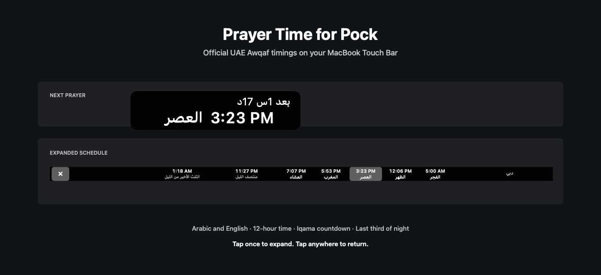

<div align="center">

# SalahTouch

**Prayer times, at your fingertips.**

Worldwide prayer times, iqama countdowns, and night calculations on the MacBook Touch Bar.

[](https://support.apple.com/macos)
[](https://www.swift.org/)
[](https://pock.app/)
[](https://aladhan.com/prayer-times-api)
[](https://www.awqaf.gov.ae/prayer-times?lang=en)
[](LICENSE)



</div>

SalahTouch is a worldwide prayer-time extension built specifically for the MacBook Touch Bar through Pock. It keeps the next salah visible without opening an app, selects timings for your location, refreshes every six hours, and keeps a cached schedule available between network requests.

## Highlights

| | |
|---|---|
| **Worldwide timings** | Uses AlAdhan's location-selected calculation method outside the UAE. |
| **Official UAE timings** | Prioritizes the UAE General Authority of Islamic Affairs and Endowments inside the UAE. |
| **Native Touch Bar interaction** | Tap to expand the full schedule; tap anywhere to return with the native reverse animation. |
| **Arabic and English** | Localized labels with a consistent 12-hour clock and English digits. |
| **Automatic or manual location** | Uses CoreLocation, with latitude and longitude controls available in Pock settings. |
| **Iqama countdown** | Defaults to 20 minutes after each prayer and 5 minutes after Maghrib. |
| **Night calculations** | Shows Islamic midnight and the beginning of the last third of the night. |

## Touch Bar States

### Full schedule

The expanded view shows all five prayers, the calculated night times, your location, and a gray highlight on the upcoming prayer.


### Compact states

| Next prayer | Iqama countdown | Final five minutes |
|:---:|:---:|:---:|
|  |  |  |

## Install

### Download

1. Download `SalahTouch.pock.zip` from the [latest release](https://github.com/GhalebAldoboni/salah-touch/releases/latest) and unzip it.
2. Quit Pock.
3. Double-click the widget, or place it in:

   ```text
   ~/Library/Application Support/Pock/Widgets/SalahTouch.pock
   ```

4. Start Pock and add **SalahTouch** from the widget manager.
5. Allow location access when macOS asks, or select manual coordinates in the widget settings.

### Build from source

```bash
git clone https://github.com/GhalebAldoboni/salah-touch.git
cd salah-touch
./build-widget.sh
```

The signed development bundle is created at `build/PrayerTimeWidget.pock`.

## Configuration

Open Pock's widget manager and select **SalahTouch**.

| Setting | Options |
|---|---|
| Language | Arabic or English |
| Location | Device location or manual coordinates |
| Coordinates | Latitude from -90 to 90; longitude from -180 to 180 |
| Asr method | Standard (Shafi, Maliki, Hanbali) or Hanafi; used outside the UAE |
| Default iqama | 0 to 120 minutes; default 20 |
| Maghrib iqama | 0 to 120 minutes; default 5 |

The widget displays times in 12-hour format, caches location and schedule data locally, and requests a fresh schedule every six hours.

## Night Calculation

The Islamic night is measured from Maghrib to the following Fajr. Its length changes throughout the year, so the widget calculates both values from each day's official schedule:

```text
Islamic midnight = Maghrib + (night duration / 2)
Last third starts = Maghrib + (night duration × 2 / 3)
```

For a night from `7:00 PM` to `4:00 AM`, Islamic midnight is `11:30 PM` and the last third starts at `1:00 AM`.

## Data Sources

SalahTouch chooses its provider from the selected coordinates:

- **United Arab Emirates:** the [official UAE Awqaf prayer-time service](https://www.awqaf.gov.ae/prayer-times?lang=en).
- **All other regions:** the [AlAdhan Prayer Times API](https://aladhan.com/prayer-times-api), which selects the closest calculation authority for the coordinates.

For UAE schedules, the widget follows the public Awqaf web flow:

1. Request a short-lived client token.
2. Map the selected coordinates to the nearest official UAE area.
3. Load the prayer schedule for yesterday, today, and tomorrow.

Both providers load a three-day window so the previous Maghrib and following Fajr remain available for calculations around midnight. UAE schedules remain on Awqaf and retry normally if the official service is temporarily unavailable.

## Privacy

- No analytics or advertising SDKs.
- No account is required.
- Automatic mode sends coordinates rounded to roughly 100-meter precision to Awqaf in the UAE or AlAdhan elsewhere.
- Manual coordinates can be used instead of granting macOS location access.
- Cached schedules and settings remain in Pock's local preferences.

## Development

Requirements: macOS 10.15 or later, a Touch Bar-equipped MacBook Pro, Pock, and the Swift toolchain.

```bash
# Build and run the calculation tests
swift test

# Package and ad-hoc sign the widget
./build-widget.sh

# Regenerate README screenshots
swift scripts/render-screenshots.swift
```

The calculation suite covers variable-length nights, midnight, the last third, and invalid schedule boundaries.

## License

Released under the [MIT License](LICENSE).
